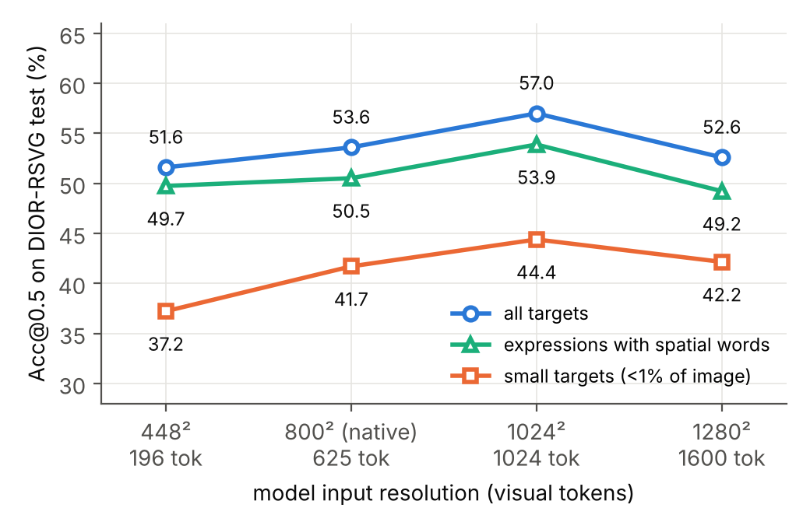
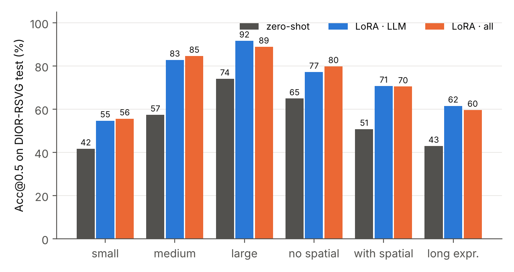
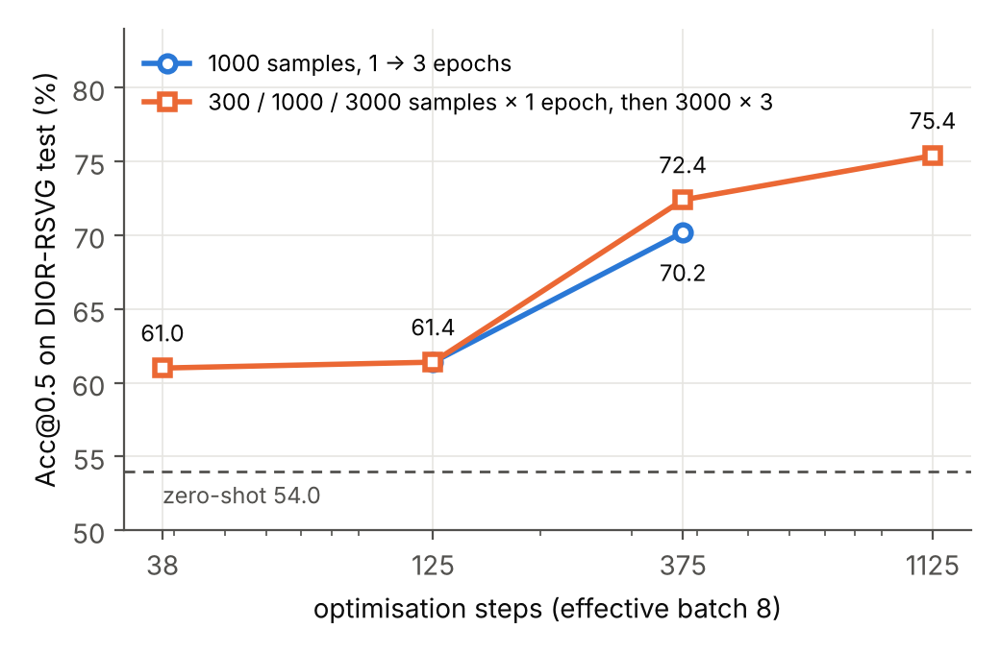
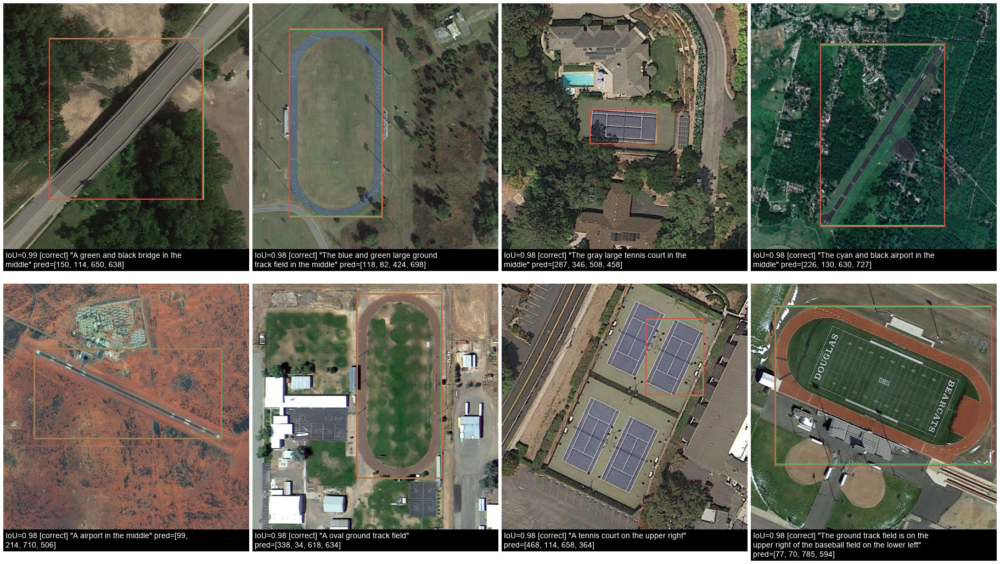
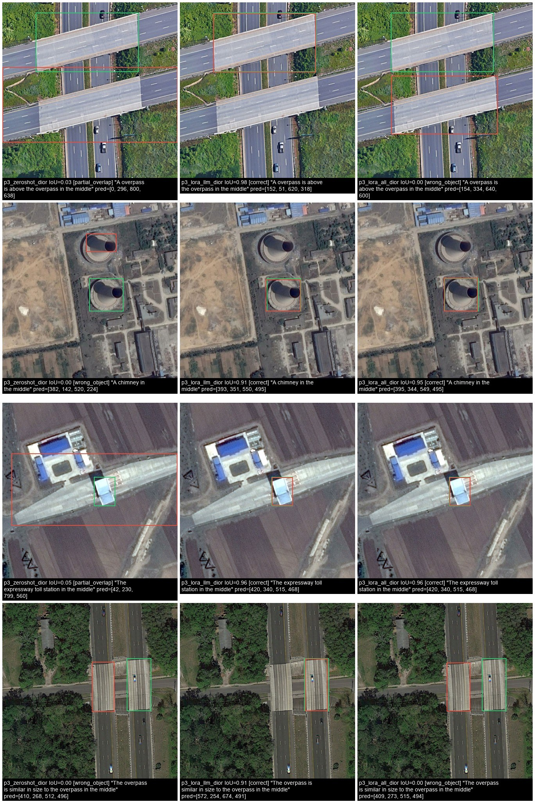
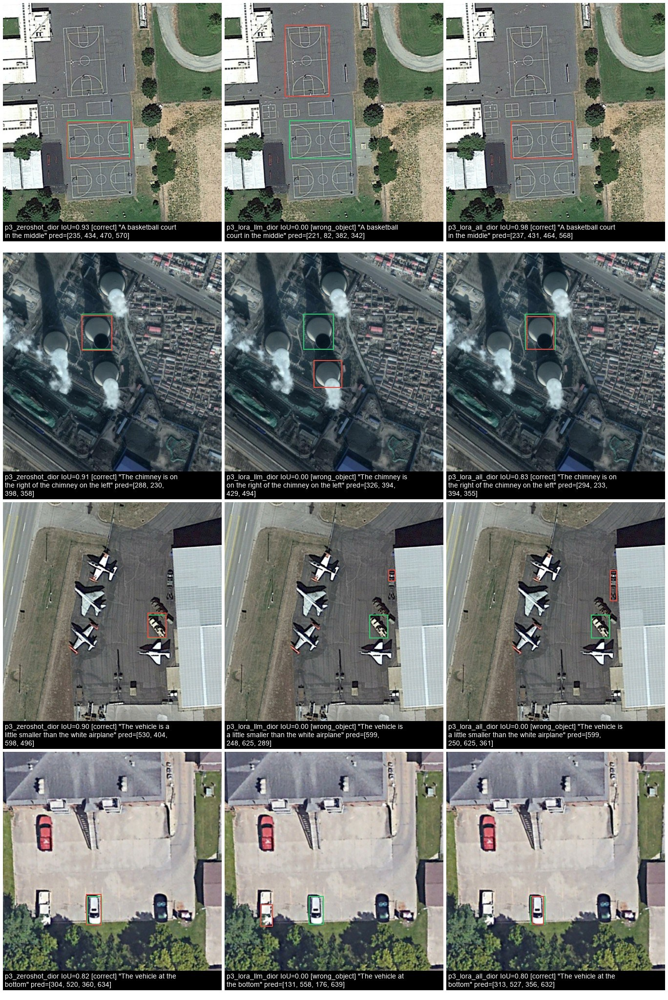
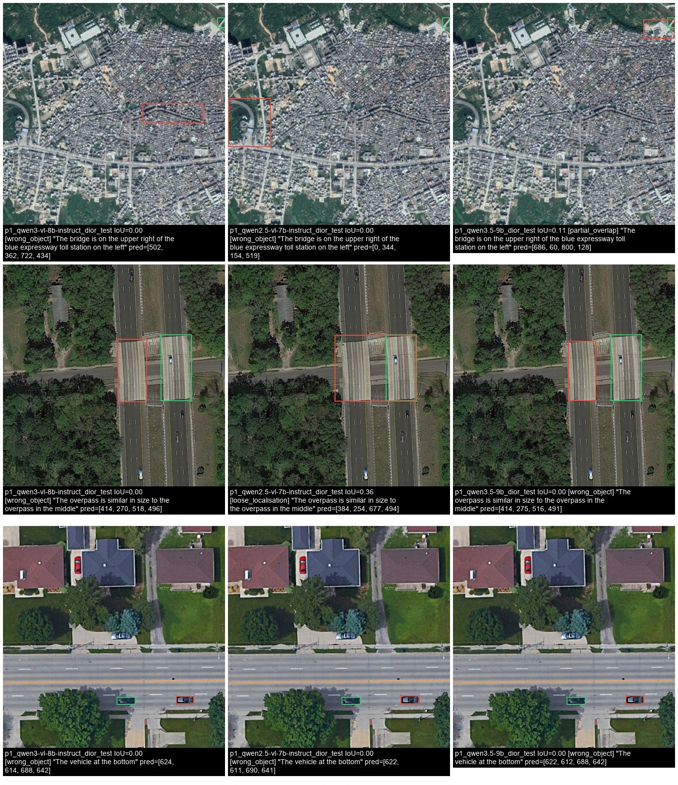

<!--
DRAFT v2 — 使用说明（提交前删除这段注释）
- 所有数字来自 runs/*/metrics.json 与 runs/compare_*.txt，没有占位符了；唯一可选项是 4.1 的 Thinking 段落（若跑了 p0b 就换成实测）。
- 这是初稿：请逐段改成你自己的表述，核对每个数字，并按课程规定申报 AI 辅助。
- 图在 docs/figures/（generations_*.jpg 需先 git pull 后重跑 .\experiments\p4_visualize.ps1 生成）。
- 转 PDF：cd docs; pandoc report.md -o ../report.pdf --pdf-engine=xelatex（或整体贴进 Word）。
-->

# Visual Grounding with Qwen3-VL: Reproduction, Out-of-Domain Analysis, and Parameter-Efficient Adaptation

**Author:** Ella Wang · **Course assignment 1 (individual)** · Code: https://github.com/Ellawjjjj/90-individual

## Abstract

Referring expression comprehension (REC) asks a model to localise the object described by a natural-language phrase. Recent vision–language models (VLMs) solve it by emitting box coordinates as text, which makes them open-vocabulary but also raises questions about precision, domain transfer, and adaptation. This report studies Qwen3-VL (Qwen Team, 2025) on REC. We (i) reproduce its RefCOCO/RefCOCO+/RefCOCOg results on a single consumer GPU, obtaining an 8-split average of 87.7 (4B) and 88.1 (8B) Acc@0.5 against 89.0 / 89.1 reported in the paper; (ii) measure transfer to two datasets outside the original paper — remote-sensing imagery (DIOR-RSVG) and GUI screenshots (ScreenSpot) — where the 4B model drops from 92.6 to 53.6 and 56.0 Acc@0.5, and compare three model generations (Qwen2.5-VL-7B, Qwen3-VL-4B/8B, Qwen3.5-9B) under one protocol: the generation gap out of domain (14–31 points) dwarfs the scale gap (≤2 points, not significant); (iii) analyse hyper-parameters (visual-token budget, model scale, decoding) and ablate the components of a LoRA adaptation recipe (which side of the model adapts, rank, training data vs. optimisation steps, forgetting); and (iv) characterise failure modes with paired statistical tests and qualitative examples. Three findings stand out. First, resolution helps only modestly (+3.4 points at 1024², p=0.016) and not beyond that; the dominant out-of-domain failure is relational reasoning over same-category instances, not visual acuity. Second, a LoRA on the language model alone (0.74% of parameters, 13 minutes of training) recovers most of the gap (+18.2 points, 95% CI [+14.4, +22.2]), mostly on expressions with spatial relations; adapting the vision tower in addition tightens boxes (Acc@0.75 +4.2) but doubles forgetting on RefCOCO. Third, among all training factors, the number of optimisation steps matters most: at a fixed 375 steps, tripling the training data adds a non-significant +2.0, whereas tripling the steps on the same data adds +8.8 (p<0.0001).

## 1 Introduction

Visual grounding — locating the image region referred to by a sentence such as *"the chimney on the right of the chimney on the left"* — sits between detection and language understanding. Classic approaches train a detector with a text-conditioned head (MDETR, Grounding DINO). Generalist VLMs take a different route: the image is encoded into visual tokens, the language model reads the expression, and the answer is a *string* of coordinates. This design gives open-vocabulary grounding for free and lets one model serve many tasks, but it also means localisation quality depends on how well the language model has learned to map tokens to pixel positions, and on how the image was tokenised.

We select Qwen3-VL (Qwen Team, 2025) as the method to analyse. It is open, available at 2B–8B parameters, documents its grounding protocol (Section 5.5 of the technical report), and sits at the end of a lineage (Qwen2-VL → Qwen2.5-VL → Qwen3-VL → Qwen3.5) that changed the coordinate convention twice, which makes it a good object for an evaluation study. All experiments run on one RTX 5090 (32 GB) under Windows with Hugging Face `transformers` and `peft` only.

The report answers four questions:

- **RQ1 (reproduction).** Can the paper's RefCOCO-family numbers be reproduced with an independent evaluation pipeline and a random subset of each split?
- **RQ2 (generalisation).** How much is lost on domains absent from the paper — remote sensing and GUI screenshots — and *which* kinds of expressions and targets fail?
- **RQ3 (hyper-parameters).** How sensitive is grounding accuracy to the visual-token budget (input resolution), model scale, and decoding?
- **RQ4 (adaptation and ablation).** When the model is adapted to a new domain with LoRA, which component carries the gain — the language model or the vision tower — and how do rank, training data, optimisation steps, and resolution trade off against accuracy and forgetting?

Contributions: an independent reproduction (Section 4.1); an evaluation on two out-of-paper datasets with per-bucket analysis (4.2); a hyper-parameter study (4.3); a controlled ablation of a LoRA recipe including a data-vs-steps decomposition and a forgetting measurement (4.4); and a qualitative analysis with paired tests that separates genuine improvements from noise (4.5). The code, run metadata, and all statistical outputs are in the repository.

## 2 Background and Related Work

**Specialised REC models.** MDETR (Kamath et al., 2021) modulates a DETR detector with text; Grounding DINO (Liu et al., 2023) aligns a DINO detector with language for open-set detection; Florence-2 (Xiao et al., 2024) unifies grounding with other tasks in a sequence-to-sequence model. They regress boxes with dedicated heads and are fast at inference.

**Grounding with generalist VLMs.** Qwen2-VL (Wang et al., 2024) introduced dynamic resolution with M-RoPE and emitted coordinates normalised to a 0–1000 grid; Qwen2.5-VL switched to absolute pixel coordinates in the resized input; Qwen3-VL returns to relative coordinates and adds interleaved-MRoPE, DeepStack (injecting multi-level ViT features into the LLM), and text-based timestamps for video. Qwen3.5 is an early-fusion unified model with a hybrid thinking mode. InternVL follows a similar recipe. The coordinate convention is not an implementation detail: Section 3.2 shows that reading the output with the wrong convention collapses accuracy from 0.85 to 0.09 IoU.

**Vision encoders and feature learning.** The vision tower of these VLMs descends from language-supervised encoders (CLIP, SigLIP 2), while self-supervised encoders (DINOv2/v3) are known for stronger dense features. Whether a VLM's grounding bottleneck lies in the encoder or in the language model is exactly the question our scope ablation (4.4a) addresses.

**Post-training for grounding.** EGM (NVIDIA, 2026) applies SFT and GRPO on top of Qwen3-VL and raises the RefCOCO average from 87.8 to 91.4 for the 8B-Thinking model, showing that the base model is not saturated. Our LoRA study is a lightweight, single-GPU counterpart.

**Datasets outside the paper.** DIOR-RSVG (Zhan et al., 2023) provides 38,320 expressions over 800×800 remote-sensing images with 20 object categories; ScreenSpot (Cheng et al., 2024) provides 1,272 GUI screenshots with element-level instructions.

## 3 Method

### 3.1 Model

Qwen3-VL consists of a ViT encoder (patch size 16), a 2×2 patch merger that produces one visual token per 32×32 pixel block, and a decoder-only LLM. Images are processed at native resolution within a pixel budget, so an 800×800 image yields 625 visual tokens and a 1024×1024 image 1,024 tokens. We use the Instruct checkpoints (4B, 8B) for most experiments and the Thinking checkpoints for one comparison.

### 3.2 Grounding as text generation

The prompt is the one used in the Qwen3-VL cookbook: `Locate the "<expression>" in the image and output its bbox coordinates in JSON format.` The model answers with a JSON list such as `[{"bbox_2d": [122, 539, 382, 808], "label": "..."}]`. We parse the first box with a fallback chain (fenced JSON → raw JSON → `[a, b, c, d]` regex → `(x,y),(x,y)` pairs) and strip any `<think>…</think>` segment first.

**Coordinate calibration.** Because conventions differ across model generations, the evaluation script does not assume one. On the first 32 samples it interprets the raw numbers under three hypotheses — relative to a 0–1000 grid, absolute pixels in the resized input, absolute pixels in the original image — and keeps the one with the highest mean IoU. For Qwen3-VL the scores are 0.854 / 0.094 / 0.094, i.e. unambiguous. Every run records the chosen convention and the actual input size seen by the model, which also guards against silently ignored resolution settings (an issue we hit once with a newer `transformers` release).

### 3.3 Evaluation protocol and statistics

The metric is Acc@0.5 (IoU ≥ 0.5 between the predicted and ground-truth box), as in the paper; we also report Acc@0.75, mean IoU, parse-failure rate, and seconds per sample. Each split is evaluated on a random subset of 500 expressions drawn with a fixed seed; subsets are *nested* (the first 100 of a 500-subset are the 100-subset), so runs of different size can be paired on shared samples.

With n=500 the standard error of a single accuracy is about ±2.2 points, so unpaired differences below ~4 points are not interpretable. All comparisons between runs on the same samples therefore use a paired bootstrap 95% confidence interval on the accuracy difference and an exact McNemar test on the discordant pairs; we also report how many samples flipped from wrong to right (N₊) and from right to wrong (N₋). To expose *where* a model fails, every run is broken down by target area (small <1% of the image, medium 1–10%, large >10%), expression length (≤3, 4–7, ≥8 words), and whether the expression contains a spatial word (left, right, middle, below, …).

### 3.4 Parameter-efficient adaptation

LoRA adapters (Hu et al., 2022; PEFT implementation) are attached to all `nn.Linear` layers of a chosen *scope*: **LLM** (the language model only — 252 layers, 33.0 M parameters, 0.74% of the model at rank 16), **vision** (the ViT and the patch merger), or **all**. Defaults: rank 16, α=32, dropout 0.05, learning rate 1e-4 with cosine decay and 3% warm-up, effective batch 8 (2 × 4 accumulation), bf16, gradient checkpointing, one epoch. The supervised target is the same JSON answer format with the ground-truth box in the model's own coordinate convention, and the loss is applied to assistant tokens only. Training data are drawn from the DIOR-RSVG training split.

### 3.5 Datasets

| Dataset | Domain | Role | Used here | Source |
|---|---|---|---|---|
| RefCOCO / RefCOCO+ / RefCOCOg | natural images (COCO) | reproduction; forgetting check | 8 splits × 500 expressions | lmms-lab Hugging Face uploads |
| DIOR-RSVG | remote sensing, 800×800, 20 classes | out-of-domain evaluation; LoRA training | test: 500; train: 300–3,000 | Zhan et al. (2023), official splits |
| ScreenSpot | GUI screenshots | out-of-domain evaluation | test: 500 | Cheng et al. (2024) |
| Synthetic shapes | — | pipeline check | 106 | generated |

The synthetic set (coloured shapes on a plain background) is a sanity check for the pipeline: the 4B model reaches Acc@0.5 = 1.00 on it, so any failure on real data is attributable to the data, not to parsing or coordinate handling.

### 3.6 Implementation

Hardware: one RTX 5090 (32 GB). Software: PyTorch (CUDA 12.8), `transformers` 5.22, `peft`; no detection framework. Zero-shot evaluation runs at 0.35–0.43 s per sample (batch 4, native resolution); LoRA training on 3,000 samples takes 13 min at 800² and 29 min at 1024². All scripts, run configurations and raw statistical outputs are in the repository (`experiments/*.ps1`, `runs/*.md`, `runs/compare_*.txt`).

## 4 Experiments and Analysis

### 4.1 Reproduction (RQ1)

Table 1 compares our subset accuracies with the paper's RefCOCO-avg (the paper reports the 8-split average only). We reproduce the reported numbers to within about one point for both models, and the two models are essentially tied (87.7 vs. 88.1), as in the paper (89.0 vs. 89.1). The remaining 1.0–1.3 gap is systematic rather than random — the standard error of an 8-split average over 4,000 samples is ±0.5 — and is plausibly due to prompt wording, greedy decoding, and subset sampling; we did not tune anything to close it. The per-split difficulty ordering matches independent measurements of the Thinking checkpoints (EGM model cards): RefCOCO+ testB, which bans location words and contains non-person objects, is the hardest split for every model.

**Table 1.** Acc@0.5 (%) on 500-expression subsets of each split; paper numbers from Table 4 of the Qwen3-VL report (full splits).

| Model | RC val | RC testA | RC testB | RC+ val | RC+ testA | RC+ testB | RCg val | RCg test | Avg (ours) | Avg (paper) | Δ |
|---|---|---|---|---|---|---|---|---|---|---|---|
| Qwen3-VL-4B-Instruct | 92.6 | 91.6 | 88.4 | 84.2 | 89.2 | 81.6 | 88.4 | 85.8 | 87.7 | 89.0 | −1.3 |
| Qwen3-VL-8B-Instruct | 92.2 | 91.6 | 88.4 | 86.8 | 90.4 | 79.8 | 87.8 | 87.8 | 88.1 | 89.1 | −1.0 |

Parse failures are rare (0–0.4% per split) and 8B is barely slower than 4B (0.38–0.43 vs. 0.35–0.41 s/sample), because outputs are short and decoding is memory-bound. *Takeaway: the evaluation pipeline is faithful, and grounding accuracy on RefCOCO is saturated at 4B.*

**Thinking vs. Instruct.** We did not evaluate the Thinking checkpoints ourselves: each query generates a reasoning chain of up to several thousand tokens, i.e. 10–40 s per sample, which did not fit the compute budget of this study. The paper's Table 4 reports that Thinking is slightly *below* Instruct on RefCOCO-avg at every scale (84.8 vs. 85.6 at 2B, 88.2 vs. 89.0 at 4B, 88.2 vs. 89.1 at 8B), and independent per-split measurements of the Thinking checkpoints (EGM model cards; last two rows of `runs/table_p0_vs_paper.md`) give 87.1 / 88.0 — within a point of our Instruct numbers. Explicit reasoning therefore does not help grounding, which is consistent with our finding that the model's failures are instance-selection errors rather than errors a longer deliberation would fix. [If `experiments/p0b_thinking.ps1` is run, replace this paragraph with the paired result from `runs/compare_thinking_*.txt`.]

### 4.2 Out-of-domain generalisation (RQ2)

**Remote sensing.** On DIOR-RSVG the 4B model falls from 92.6 (RefCOCO val) to 53.6 Acc@0.5 — a 39-point drop — and the breakdown (Table 2) shows that the loss is structured. Accuracy decreases monotonically with target size (large 75.0 → medium 55.6 → small 41.7) and with expression length (70.3 → 57.0 → 42.9), and expressions with spatial words are *worse* than those without (50.5 vs. 64.0). On RefCOCO the last relation is reversed (93.7 vs. 90.7): spatial words help when they disambiguate a few distinct objects, and hurt when the scene is a grid of near-identical airplanes or storage tanks and the expression is a relational template such as *"the vehicle that is a little smaller than the vehicle on the lower left"*.

**Table 2.** Qwen3-VL-4B-Instruct, zero-shot, Acc@0.5 by bucket (n in parentheses).

| Dataset | All | Small | Medium | Large | No spatial | With spatial | ≤3 w | 4–7 w | ≥8 w |
|---|---|---|---|---|---|---|---|---|---|
| RefCOCO val | 92.6 (500) | – (0) | 89.1 (137) | 93.9 (363) | 90.7 (182) | 93.7 (318) | 95.1 (304) | 89.5 (171) | 84.0 (25) |
| DIOR-RSVG test | 53.6 (500) | 41.7 (223) | 55.6 (169) | 75.0 (108) | 64.0 (114) | 50.5 (386) | 70.3 (37) | 57.0 (307) | 42.9 (156) |

**GUI screenshots and model generations.** Table 3 evaluates four models of three generations on the three datasets under the same prompt, parser and subsets. For Qwen2.5-VL the calibration step selects the absolute-pixel convention (mean IoU 0.89 vs. 0.06 for the relative one), confirming that the convention changed between generations and that a fixed parser would have scored it near zero. Qwen3.5-9B runs in its non-thinking mode.

**Table 3.** Acc@0.5 (%) of three model generations; Δ is the paired difference against Qwen3-VL-8B on the same 500 samples (95% CI; * = CI excludes 0). Parse-failure rate and latency are given for ScreenSpot, where they vary most.

| Model | Coordinates | RefCOCO val | DIOR-RSVG test | ScreenSpot | Parse fail (SS) | s/sample (SS) |
|---|---|---|---|---|---|---|
| Qwen2.5-VL-7B-Instruct | absolute (input) | 90.0 (−2.2 [−4.8, +0.2]) | 41.6 (−14.2 [−18.2, −10.2]*) | 26.6 (−31.2 [−36.0, −26.6]*) | 2.2% | 2.5 |
| Qwen3-VL-4B-Instruct | relative 0–1000 | 92.4 (+0.2 [−1.8, +2.2]) | 53.6 (−2.2 [−5.6, +1.2]) | 56.0 (−1.8 [−5.4, +2.0]) | 10.0% | 1.2 |
| Qwen3-VL-8B-Instruct | relative 0–1000 | 92.2 | 55.8 | 57.8 | 7.6% | 2.0 |
| Qwen3.5-9B (non-thinking) | relative 0–1000 | 92.4 (+0.2 [−1.8, +2.4]) | 57.2 (+1.4 [−2.0, +4.8]) | 61.6 (+3.8 [−0.4, +8.2]) | 0.0% | 4.1 |

Three observations. (1) In domain, all four models are tied within 2 points. (2) Out of domain, the *generation* gap is large and significant — Qwen2.5-VL-7B loses 14 points on DIOR-RSVG and 31 on ScreenSpot relative to Qwen3-VL-8B (N₊/N₋ = 23/94 and 21/177) — whereas the *scale* gap within Qwen3-VL (4B vs. 8B) is ≤2 points and not significant on any dataset. (3) Qwen3.5-9B is the best model on both out-of-domain sets (57.2 and 61.6) but the margin over Qwen3-VL-8B is not significant on DIOR-RSVG and only borderline on ScreenSpot (p=0.099), at 2–4× the latency of Qwen3-VL-8B. ScreenSpot is hard for a different reason than DIOR-RSVG: its targets are tiny GUI elements in 2528×1184 screenshots (292 of 500 are "small", only 30 expressions contain spatial words), and Qwen3-VL produces 7.6–10% unparseable answers on it — Section 4.3 shows these are refusals on functional instructions, not truncations. Qwen3.5-9B, by contrast, never refuses.

*Takeaway: the domain gap is dominated by small, densely repeated targets described through relations (DIOR-RSVG) and by tiny elements in very large images (ScreenSpot); it is a reasoning and output-format problem as much as a perception problem, and newer generations close it faster than larger models do.*

### 4.3 Hyper-parameter analysis (RQ3)

**Visual-token budget (input resolution).** Qwen3-VL processes images at native resolution within a configurable pixel budget; we force 800×800 DIOR images to 448², 1024² and 1280² (196, 1024 and 1600 visual tokens; Figure 1, Table 4). Upscaling to 1024² gives a significant but modest gain (+3.4 points, 95% CI [+0.8, +6.0], p=0.016; N₊=31, N₋=14), concentrated on small targets (41.7 → 44.4) and large targets (75.0 → 78.7). Going further to 1280² gives nothing back (−1.0, CI [−3.8, +1.8]) while doubling latency, and downscaling to 448² costs only 2.0 points (CI [−5.2, +1.2], not significant). Across all four settings the spatial-word bucket stays within 49–54 and the long-expression bucket within 40–47.

**Table 4.** Resolution sweep, Qwen3-VL-4B-Instruct, DIOR-RSVG test (n=500). Δ is paired against the native run.

| Input | Tokens | Acc@0.5 | Acc@0.75 | Small | With spatial | s/sample | Δ vs. native [95% CI], p |
|---|---|---|---|---|---|---|---|
| 448² | 196 | 51.6 | 32.6 | 37.2 | 49.7 | 0.37 | −2.0 [−5.2, +1.2], 0.28 |
| 800² (native) | 625 | 53.6 | 35.4 | 41.7 | 50.5 | 0.39 | — |
| 1024² | 1024 | **57.0** | 37.4 | **44.4** | 53.9 | 0.76 | **+3.4 [+0.8, +6.0], 0.016** |
| 1280² | 1600 | 52.6 | 37.0 | 42.2 | 49.2 | 0.84 | −1.0 [−3.8, +1.8], 0.58 |

*Figure 1. Acc@0.5 vs. input resolution on DIOR-RSVG for all targets, small targets, and expressions with spatial words.*

**Model scale.** 4B and 8B are tied on RefCOCO (Table 1) and remain within 2 points of each other on DIOR-RSVG (53.6 vs. 55.8, paired −2.2, CI [−5.6, +1.2], p=0.25) and ScreenSpot (56.0 vs. 57.8, −1.8, CI [−5.4, +2.0], p=0.41). Doubling the language model does not buy grounding accuracy in or out of domain; the extra capacity shows up only in Acc@0.75 on RefCOCO (84.2 vs. 82.8) and in a lower parse-failure rate on ScreenSpot.

**Generation budget and refusals.** All main results use greedy decoding (temperature 0) and a 128-token budget. On natural and remote-sensing images this is ample (parse failures ≤0.4%), but on ScreenSpot Qwen3-VL returns no parseable box in 7.6–10% of cases. We first hypothesised truncation and re-ran the 4B model with a 512-token budget: the result is identical to the token (Acc@0.5 56.0 vs. 56.0, zero flipped samples, parse failures 9.8% vs. 10.0%). Reading the 50 failed outputs shows why: every one is a *refusal* — "There are none." or "There is no object matching the query in the image." — on instructions such as *file processing*, *adjust the volume*, *check my apple id*, *siri*. These ScreenSpot instructions describe the *function* of a UI element, not its appearance; the model treats them as referring to objects that are absent and declines, which the metric counts as an error. Qwen2.5-VL-7B refuses 2.2% of the time and Qwen3.5-9B never does, so refusal behaviour is a property of the checkpoint's post-training rather than of the input, and it accounts for about half of the 4B–Qwen3.5 gap on ScreenSpot (5.6 points). Because the prompt yields near-zero parse failures elsewhere, we did not sweep prompt wording or temperature; a prompt that forbids refusal is an obvious follow-up.

*Takeaway: the model is insensitive to resolution within a wide band — a 1.6× token budget buys 3 points, mostly on small objects, and nothing beyond that — and insensitive to scale; on screenshots the decisive factor is not any budget but whether the model is willing to ground a functional instruction at all.*

### 4.4 Ablation of the adaptation recipe (RQ4)

All ablations fine-tune Qwen3-VL-4B-Instruct on DIOR-RSVG training data and evaluate on the same 500 test expressions; the zero-shot baseline is 54.0 Acc@0.5. (This run and the 53.6 above are the same configuration evaluated with batch size 2 vs. 4; the 0.4-point difference is bf16 batch-composition noise and bounds the resolution of unpaired comparisons.)

**(a) Which side adapts?** Table 5 compares LoRA on the LLM, on the vision tower, and on both (rank 16, 3,000 samples, one epoch). The LLM-only adapter — 0.74% of parameters, 13 minutes — delivers almost the entire Acc@0.5 gain: +18.2 points (CI [+14.4, +22.2], p<0.0001; N₊=104, N₋=13). Adapting only the vision tower gives +10.8. Adapting both is statistically indistinguishable from LLM-only on Acc@0.5 (+0.4, CI [−2.8, +3.4], p=0.90; flips are symmetric, 31 vs. 33), but it is better on Acc@0.75 (61.0 vs. 56.8) — boxes are tighter — and its forgetting on RefCOCO is twice as large (−4.4 vs. −2.4 points, both significant). The buckets (Figure 2) tell where each side acts: the LLM adapter lifts the spatial-word bucket from 50.8 to 70.7 and long expressions from 42.9 to 61.5, i.e. it fixes *which* object is selected; the vision adapter contributes to localisation precision and to small targets.

**Table 5.** LoRA scope ablation (DIOR-RSVG test, n=500). RefCOCO column: Acc@0.5 on RefCOCO val after adaptation (zero-shot 92.6).

| Scope | Acc@0.5 | Acc@0.75 | Small | With spatial | ≥8 words | Δ vs. zero-shot [CI] | RefCOCO val (Δ, p) |
|---|---|---|---|---|---|---|---|
| zero-shot | 54.0 | 35.8 | 41.7 | 50.8 | 42.9 | — | 92.6 |
| LLM | 72.2 | 56.8 | 54.7 | 70.7 | 61.5 | +18.2 [+14.4, +22.2] | 90.2 (−2.4, p=0.017) |
| vision | 64.8 | 54.0 | 51.6 | 64.0 | 51.9 | +10.8 [+7.0, +14.6] | 90.4 (−2.2, p=0.027) |
| all | 72.6 | **61.0** | 55.6 | 70.5 | 59.6 | +18.6 [+14.6, +22.8] | 88.2 (−4.4, p=0.0002) |

*Figure 2. Per-bucket Acc@0.5 for zero-shot, LLM-LoRA and all-LoRA on DIOR-RSVG.*

**(b) Rank.** Ranks 4, 16 and 64 (LLM scope) give 67.0, 72.2 and 73.8. The step from 4 to 16 is significant (+5.2, CI [+2.8, +7.8], p=0.0001); from 16 to 64 it is not (+1.6, CI [−1.0, +4.2], p=0.30) despite four times the adapter parameters (132 M vs. 33 M).

**(c) Training data vs. optimisation steps.** A naive sweep over 300 / 1,000 / 3,000 training samples at one epoch gives 61.0 / 61.4 / 72.4, which looks like a data-scaling curve. It is mostly a *steps* curve: with one epoch, 3,000 samples also means three times as many optimiser steps. Training the 1,000-sample set for three epochs (375 steps, the same as 3,000 × 1) recovers 70.2 — a gain of +8.8 points over one epoch (CI [+5.6, +12.2], p<0.0001) — and is not significantly below the 3,000-sample run at equal steps (−2.0, CI [−4.6, +0.6], p=0.16). Continuing to 1,125 steps (3,000 × 3 epochs) yields the best single configuration, 75.4 (+3.0 over 375 steps, CI [+0.2, +5.8], p=0.049). Table 6 and Figure 3 summarise this.

**Table 6.** Data vs. steps (LLM scope, rank 16, DIOR-RSVG test).

| Train samples | Epochs | Steps | Acc@0.5 | Acc@0.75 | Small | With spatial |
|---|---|---|---|---|---|---|
| 300 | 1 | 38 | 61.0 | 45.6 | 46.2 | 57.8 |
| 1,000 | 1 | 125 | 61.4 | 47.4 | 42.6 | 58.5 |
| 1,000 | 3 | 375 | 70.2 | 55.2 | 52.5 | 69.9 |
| 3,000 | 1 | 375 | 72.4 | 56.0 | 54.7 | 70.5 |
| 3,000 | 3 | 1,125 | **75.4** | **60.2** | **58.7** | **74.1** |

*Figure 3. Acc@0.5 vs. optimisation steps. The 1,000-sample and 3,000-sample curves nearly coincide at 375 steps.*

**(d) Resolution × adaptation.** Training and evaluating the LLM adapter at 1024² instead of 800² gives 74.2 vs. 72.2 (+2.0, CI [−0.6, +4.6], p=0.19) and the best small-target accuracy among single-epoch runs (57.8), at 2.2× the training time. The two interventions address different buckets and appear additive, but the combined effect is not significant at n=500.

**(e) Reproducibility.** Three independent trainings of the same configuration (LLM, rank 16, 3,000 × 1) reached 72.2, 72.2 and 72.4 Acc@0.5. Differences below one point between configurations are therefore within run-to-run variation, which is why Table 5's "all vs. LLM" and Table 6's "3,000 vs. 1,000 at equal steps" are reported as ties.

**(f) Thinking mode.** Not ablated here; see Section 4.1 — the paper's own numbers show the Thinking variant 0.8–0.9 points below Instruct on RefCOCO-avg at the cost of thousands of generated tokens per query.

*Takeaway: in this setting the gain lives in the language model and scales with optimisation steps; rank beyond 16, extra data at fixed steps, higher resolution, and vision-side adaptation each add at most ~2 points, and the last one costs retention of the original domain.*

### 4.5 Visualisation and case analysis

**Good cases.** On RefCOCO (`figures/refcoco_good.jpg`) predictions are tight (IoU > 0.9) even for expressions that combine attributes and relations ("white pot upper right corner"). The same holds on DIOR-RSVG whenever the target is a *large, unique* structure — a bridge, a running track, an airport runway, a tennis court (`figures/dior_good.jpg`, all IoU ≥ 0.98) — and the model handles colour attributes and even a two-object relation correctly when both objects are large ("the ground track field on the upper right of the baseball field on the lower left"). The zero-shot model therefore does *see* remote-sensing imagery well; what it fails at is selection among many similar small objects.

*Figure 4. Good cases on DIOR-RSVG (Qwen3-VL-8B, zero-shot): large, unique structures are localised with IoU ≥ 0.98. Green = ground truth, red = prediction.*

**Failure modes on DIOR-RSVG.** Inspecting the lowest-IoU zero-shot cases and the LoRA before/after grids (`figures/dior_lora_fixed.jpg`, `figures/dior_lora_broken.jpg`) reveals three recurring patterns:

1. *Reference-object confusion.* DIOR-RSVG expressions are often relational templates ("the overpass that is similar in size to the overpass in the middle"). The zero-shot model frequently boxes the *reference* ("the overpass in the middle") instead of the target. This is the pattern the LLM adapter fixes most often (104 of the 230 zero-shot errors become correct).
2. *Same-category instance selection.* In a row of identical airplanes or a pair of chimneys, only the spatial clause distinguishes the target. Zero-shot and LLM-LoRA both swap instances; the all-scope adapter resolves several of these (e.g. "the chimney in the middle", IoU 0.96).
3. *Very small targets.* Vehicles and windmills a few tens of pixels wide are missed or loosely boxed by every configuration; this is the bucket where resolution (Section 4.3) and vision-side adaptation help, and where accuracy remains lowest (58.7 at best).

*Figure 5. DIOR-RSVG cases that the LLM-LoRA adapter fixes (first four of 104). Columns: zero-shot, LoRA-LLM, LoRA-all. The zero-shot model boxes the reference object of a relational expression or a same-category neighbour. Full grid: `figures/dior_lora_fixed.jpg`.*

**Regressions after adaptation.** Fine-tuning is not monotone: the LLM adapter breaks 13 samples that the zero-shot model had right. Almost all are instance swaps on nested relational expressions ("the chimney on the right of the chimney on the left"), where the adapted model over-corrects from "box the reference" to "box the wrong side". Six of the eight regressions shown in `dior_lora_broken.jpg` are recovered by the all-scope adapter, consistent with its higher Acc@0.75 and symmetric flip counts.

*Figure 6. Regressions: zero-shot correct, LLM-LoRA wrong (first four of 13). Most are instance swaps on nested relational expressions; the all-scope adapter (right column) recovers most of them. Full grid: `figures/dior_lora_broken.jpg`.*

**GUI screenshots.** Besides the refusals discussed in Section 4.3, the ScreenSpot errors of Qwen3-VL-8B (`figures/screenspot_bad.jpg`) fall into three kinds. *Semantic neighbours:* for "open account protection" the model boxes the *Sign in* button inside the Account-protection panel rather than the sidebar entry of that name; for "take a photo to insert into the memo" it boxes the camera toolbar button that opens the menu rather than the *Take Photo* item inside it — in both cases a defensible action, but not the annotated element. *Adjacent look-alike icons:* "rotate left" is answered with the flip icon next to the rotate icon. *Tiny targets in very large images:* "finder" is answered with a desktop folder instead of the Finder icon in the dock of a 2528×1184 screenshot. The first kind is specific to GUIs, where an instruction can map to several plausible elements; the other two are the same instance-selection and small-target failures seen on DIOR-RSVG.

*Figure 7. ScreenSpot failures of Qwen3-VL-8B: semantic neighbour ("open account protection" → Sign in; "take a photo…" → camera button instead of the menu item), adjacent look-alike icon ("rotate left" → flip), tiny target ("finder" → desktop folder instead of the dock icon).*

**Cross-generation comparison.** `figures/generations_refcoco.jpg` and `generations_dior.jpg` show the ten lowest-IoU samples of Qwen3-VL-8B next to the answers of Qwen2.5-VL-7B and Qwen3.5-9B on the same images. Because the samples are selected on the 8B model's failures, the other models sometimes succeed on them (on RefCOCO, "person w/ black bag on back and rolling" is boxed correctly by both other models while 8B picks the neighbouring person); the paired counts put this in proportion — relative to Qwen3-VL-8B, Qwen2.5-VL-7B fixes 15 RefCOCO samples but breaks 26, and on DIOR-RSVG fixes 23 but breaks 94. On DIOR-RSVG the hard cases are genuinely shared: for a relational expression over a dense urban scene ("the bridge on the upper right of the blue expressway toll station on the left") all three models box different wrong regions, and for a vehicle "on the upper right of the baseball field" all three choose a different small vehicle. Newer generations shift a minority of the hard cases; the very small, relationally described targets remain unsolved by every model.

*Figure 8. The hardest DIOR-RSVG cases of Qwen3-VL-8B (left) with the answers of Qwen2.5-VL-7B (middle) and Qwen3.5-9B (right) on the same images (first three of ten). Full grids: `figures/generations_dior.jpg`, `figures/generations_refcoco.jpg`.*

### 4.6 Advantages and disadvantages

**Advantages.** (i) Open-vocabulary, zero-shot grounding with full natural-language input, including attributes and relations; no category list. (ii) One model covers natural images, remote sensing and GUIs without architectural changes. (iii) Adaptation is cheap: 0.74% of parameters and 13 minutes on one GPU give +18 points on a new domain, and the adapter is a 130 MB file that can be swapped per domain. (iv) The textual interface makes failure cases interpretable — the model's answer can be read.

**Disadvantages.** (i) Coordinates are generated as text: parsing can fail (≤0.4% here), precision is limited (Acc@0.75 lags Acc@0.5 by 10–20 points), and every query costs a full decoder pass (0.35–0.8 s/sample, orders of magnitude slower than a detector). (ii) Relational reasoning over many similar instances does not transfer across domains. (iii) Small targets remain weak; more pixels help only up to a point. (iv) Adaptation causes measurable forgetting (−2 to −4 points on RefCOCO), and the recipe needs enough optimisation steps — a single epoch on a small set under-trains. (v) The model may refuse: it correctly declines to box a *red circle* in an image that has none, but it also declines 10% of ScreenSpot instructions that name a function rather than an appearance (Section 4.3). A detector always returns its best box; a VLM's refusal is sometimes right and sometimes a missed target, and the metric cannot tell them apart.

## 5 Conclusion

We reproduced Qwen3-VL's referring-expression results to within about one point on a single consumer GPU, and used the pipeline to ask what breaks outside the paper's domains and what it takes to fix it. The model transfers poorly to remote-sensing imagery (−39 points) because of relational expressions over dense same-category instances and very small targets. Resolution is not the lever: a 1.6× token budget buys 3 points and more buys nothing. A LoRA on the language model alone recovers most of the gap, with the vision tower contributing box precision at the cost of doubled forgetting; among training factors, optimisation steps dominate, while rank, data size at fixed steps and resolution each add at most ~2 points. Paired tests were essential: of the fourteen pairwise comparisons we ran, half would have been over-interpreted from point estimates alone.

**Limitations.** Each split is a 500-expression subset, not the full set; LoRA results are single-seed except for one triplicated configuration; we did not include a specialised detector (e.g. Grounding DINO) as a reference point; the Thinking comparison uses 100 samples [or: was not run]; and the failure-mode taxonomy was assigned by inspection of a few dozen cases rather than annotated at scale.

**Future work.** RL-based post-training as in EGM; training on the full 27k DIOR-RSVG set with more steps; combining vision-side adaptation with higher resolution specifically for the small-target bucket; and a regularised adapter (e.g. mixing RefCOCO data) to remove the forgetting.

## References

- Qwen Team. *Qwen3-VL Technical Report.* arXiv:2511.21631, 2025.
- Qwen Team. *Qwen3.5.* https://qwen.ai/blog?id=qwen3.5, 2026.
- Wang et al. *Qwen2-VL: Enhancing Vision-Language Model's Perception of the World at Any Resolution.* 2024.
- Kazemzadeh et al. *ReferItGame.* EMNLP 2014; Mao et al. *Generation and Comprehension of Unambiguous Object Descriptions.* CVPR 2016 (RefCOCO/+/g).
- Zhan, Xiong, Yuan. *RSVG: Exploring Data and Models for Visual Grounding on Remote Sensing Data.* IEEE TGRS 2023.
- Cheng et al. *SeeClick: Harnessing GUI Grounding for Advanced Visual GUI Agents.* 2024 (ScreenSpot).
- Kamath et al. *MDETR.* ICCV 2021. Liu et al. *Grounding DINO.* ECCV 2024. Xiao et al. *Florence-2.* CVPR 2024.
- Hu et al. *LoRA: Low-Rank Adaptation of Large Language Models.* ICLR 2022.
- Zhan et al. *EGM: Efficient Visual Grounding Language Models.* NVIDIA, 2026 (model cards for EGM-4B/8B).
- Radford et al. *CLIP*, 2021; Tschannen et al. *SigLIP 2*, 2025; Oquab et al. *DINOv2*, 2024; Siméoni et al. *DINOv3*, 2025.

## Appendix A — Reproducing every number

| Section | Script | Outputs |
|---|---|---|
| 4.1 | `experiments/p0_reproduce.ps1` | `runs/table_p0_vs_paper.md`, `runs/summary_p0.md` |
| 4.1 Thinking | `experiments/p0b_thinking.ps1` | `runs/compare_thinking_*.txt` |
| 4.2 / 4.3 scale / 4.5 | `experiments/p1_ood_and_generations.ps1` | `runs/summary_p1.md`, `runs/compare_p1_*.txt` |
| 4.3 resolution | `experiments/p2_hyperparams.ps1` (block 1b) | `runs/summary_dior_px.md`, `runs/compare_resolution.txt` |
| 4.4 | `experiments/p3_lora_ablation.ps1` + the three extra runs listed in README | `runs/summary_p3_dior.md`, `runs/summary_p3_forgetting.md`, `runs/compare_p3_*.txt`, `compare_steps.txt`, `compare_rank.txt` |
| figures | `experiments/p4_visualize.ps1`, `tools/plot_curves.py` | `docs/figures/` |
| all tables & tests | `experiments/99_collect.ps1` | — |

Hyper-parameters not varied: prompt template `json`; greedy decoding; 128 new tokens (4096 for Thinking); bf16; SDPA attention; LoRA α = 2 × rank, dropout 0.05, lr 1e-4, cosine schedule, 3% warm-up, effective batch 8, gradient checkpointing; evaluation subsets seed 0.
